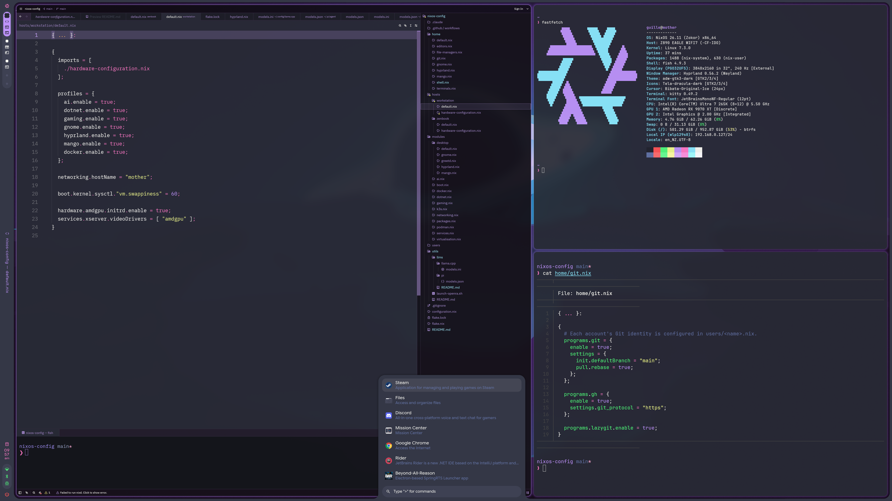
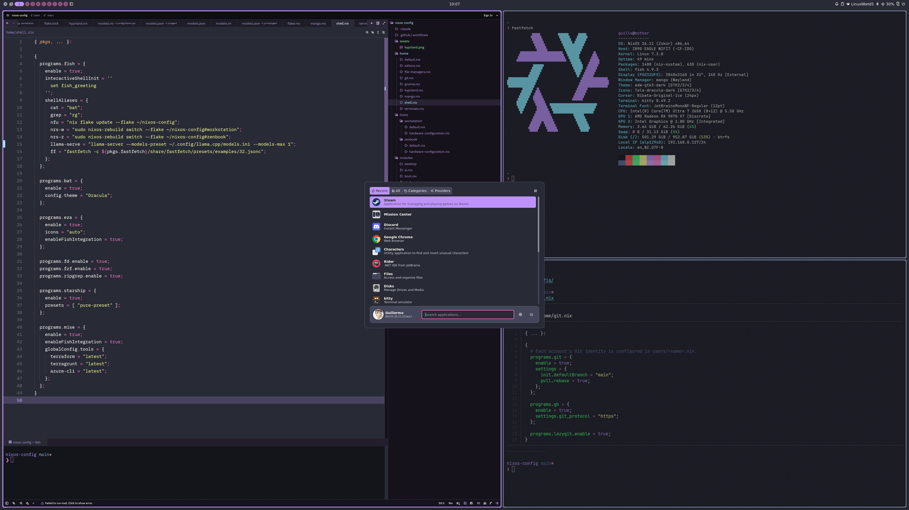

# nixos-config

NixOS configuration for my machines.

### Hyprland + Caelestia



### Mango + Noctalia



## Usage

The hosts and users in this repo are mine. To use it on your machine, add your own.

1. Clone the repo:

   ```bash
   git clone https://github.com/glexposito/nixos-config.git
   cd nixos-config
   ```

2. Create a folder for your host and generate its hardware config. Replace `<host>` with any name you like, here and in the next steps:

   ```bash
   mkdir hosts/<host>
   sudo nixos-generate-config --show-hardware-config > hosts/<host>/hardware-configuration.nix
   ```

3. Create `hosts/<host>/default.nix`. Enable the profiles you want and set your machine's hostname:

   ```nix
   { ... }:

   {
     imports = [ ./hardware-configuration.nix ];

     profiles = {
       hyprland.enable = true;
     };

     networking.hostName = "<hostname>";
   }
   ```

   Available profiles are defined in `modules/`. For a full example, see `hosts/workstation/default.nix`, my desktop with an AMD GPU.

4. Register the host in `flake.nix`, next to the existing ones:

   ```nix
   nixosConfigurations.<host> = nixpkgs.lib.nixosSystem {
     system = "x86_64-linux";
     specialArgs = { inherit inputs; };
     modules = [
       ./hosts/<host>
       ./configuration.nix
       home-manager.nixosModules.home-manager
       homeManagerModule
     ];
   };
   ```

5. Set up your users (see [Users](#users)), and set `time.timeZone` and `i18n.defaultLocale` in `configuration.nix`.

6. `git add` the new files (flakes ignore untracked files), then rebuild:

   ```bash
   sudo nixos-rebuild switch --flake .#<host>
   ```

## Users

Accounts are defined as regular NixOS modules under `users/`. This repo ships with my own accounts as examples; replace them with your own.

- `users/guille.nix` is imported by `configuration.nix`, so it exists on every host. It uses Fish, has admin access, and gets Docker access when the host enables the Docker profile.
- `users/sol.nix` is imported only by `hosts/zenbook/default.nix`, so it exists only on the Zenbook. It uses Fish with the shared shell aliases and has network management access.

Every account receives the shared `home/` configuration through `home-manager.sharedModules` in `flake.nix`. Home Manager derives each username and home directory from the corresponding NixOS account.

To define your own user, create `users/<name>.nix` with its `users.users.<name>` settings and `home-manager.users.<name>` configuration, then import it from the desired host. To make an account available on every host, import it from `configuration.nix`. Remove or replace the example accounts you don't need.

After adding a new user and rebuilding the target host, set their login password. Replace `username` with the new account's name:

```bash
sudo passwd username
```

Existing passwords are retained with NixOS's default `users.mutableUsers = true`.

## Structure

- `flake.nix` defines the flake inputs and host outputs.
- `configuration.nix` contains shared NixOS settings imported by every host.
- `home/` contains user-level Home Manager configuration (e.g. Git tooling in `home/git.nix`, Fish aliases in `home/shell.nix`).
- `users/` contains each account's NixOS settings and Git identity.
- `hosts/` contains per-machine configuration, including generated hardware files. Mine are `workstation` (`mother`, desktop with AMD GPU) and `zenbook` (`apollo`, ASUS Zenbook laptop).
- `modules/` contains reusable system profiles and feature modules that hosts can opt into.
- `utils/` contains personal scripts and reference configs for things not covered by the declarative system configuration (e.g. llama.cpp model presets).

Host files should stay small and mostly describe machine-specific choices. Shared behavior belongs in `configuration.nix`, `home/`, or a module under `modules/`.

## Profiles

Features are opt-in per host via `profiles.<name>.enable`. Desktop environments:

- **GNOME** — `profiles.gnome.enable = true`
- **Hyprland** — `profiles.hyprland.enable = true` (uses [Caelestia Shell](https://github.com/caelestia-dots/shell) with Lua config from [caelestia-dots](https://github.com/caelestia-dots/caelestia))
- **Mango** — `profiles.mango.enable = true` (uses [mango](https://github.com/mangowm/mango), a dwl-based Wayland compositor, with [Noctalia Shell](https://github.com/noctalia-dev/noctalia))

Hyprland + Caelestia is configured in `home/hyprland.nix`, and Mango + Noctalia in `home/mango.nix`. With both enabled, pick one per session from the greetd login screen.

Other features (AI, .NET, gaming, containers, k3s, virtualisation, …) use the same pattern. See `modules/` for what each one installs.
