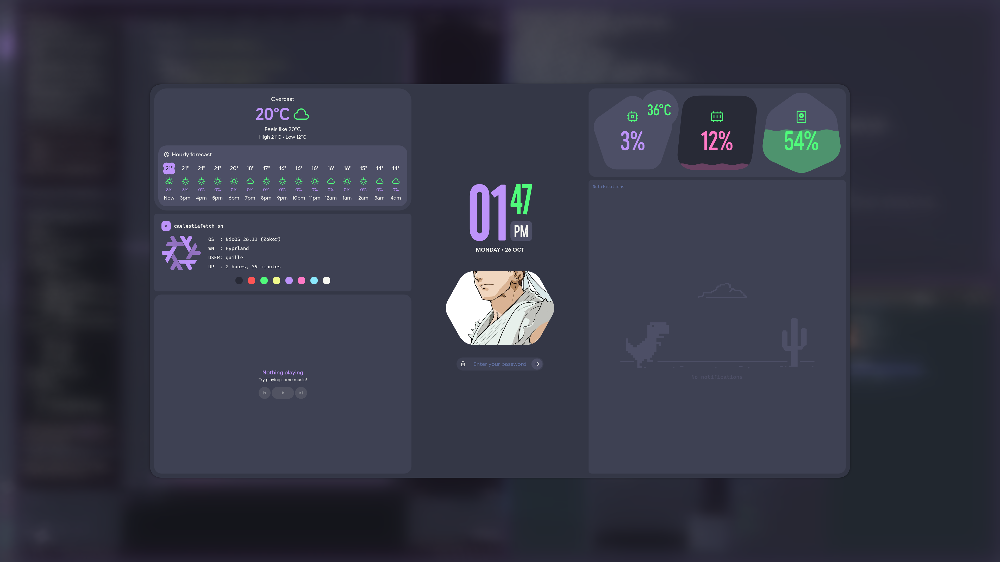
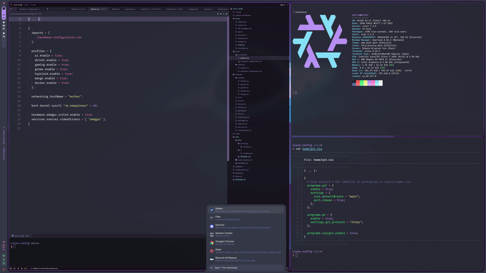
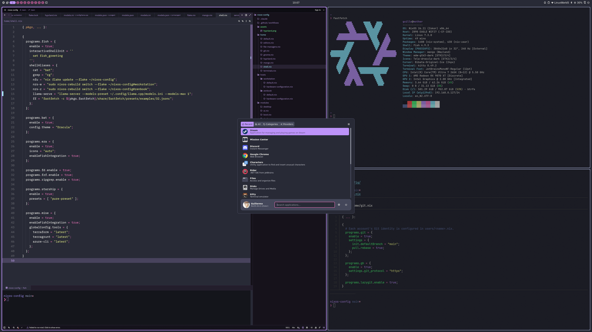

# nixos-config

NixOS configuration for my machines.

### Hyprland + Caelestia





### Mango + Noctalia



## Usage

The hosts and users in this repo are mine. To use it on your machine, add your own.

1. Clone the repo:

   ```bash
   git clone https://github.com/glexposito/nixos-config.git
   cd nixos-config
   ```

2. Create a folder for your host and generate its hardware config. Replace `<host>` with any name you like, here and in the next steps:

   ```bash
   mkdir modules/hosts/<host>
   sudo nixos-generate-config --show-hardware-config > modules/hosts/<host>/_hardware-configuration.nix
   ```

   The leading `_` keeps it out of the automatic import (see [Structure](#structure)).

3. Create `modules/hosts/<host>/default.nix`. List the features you want and set your machine's hostname:

   ```nix
   { inputs, config, ... }:
   let
     nixos = config.flake.modules.nixos;
   in
   {
     flake.nixosConfigurations.<host> = inputs.nixpkgs.lib.nixosSystem {
       modules = [
         ./_hardware-configuration.nix
         nixos.core
         nixos.guille

         nixos.hyprland

         { networking.hostName = "<hostname>"; }
       ];
     };
   }
   ```

   Available features are defined in `modules/profiles/` (see [Features](#features)). For a full example, see `modules/hosts/workstation/default.nix`, my desktop with an AMD GPU. There's nothing to register in `flake.nix`; every file under `modules/` is picked up automatically.

4. Set up your users (see [Users](#users)), and set `time.timeZone` and `i18n.defaultLocale` in `modules/core/base.nix`.

5. `git add` the new files (flakes ignore untracked files), then rebuild:

   ```bash
   sudo nixos-rebuild switch --flake .#<host>
   ```

## Users

Accounts are defined under `modules/users/`, each as `flake.modules.nixos.<name>`. This repo ships with my own accounts as examples; replace them with your own.

- `nixos.guille` is listed by both hosts. It uses Fish, has admin access, and gets Docker access on hosts that include `nixos.docker`.
- `nixos.sol` is listed only by the Zenbook, so it exists only there. It uses Fish with the shared shell aliases and has network management access.

Every account receives the shared home configuration (`homeManager.base`, from `modules/home/`) through `home-manager.sharedModules` in `modules/core/home-manager.nix`, plus the home half of each feature the host lists. Home Manager derives each username and home directory from the corresponding NixOS account.

To define your own user, create `modules/users/<name>.nix` with its `users.users.<name>` settings and `home-manager.users.<name>` configuration under `flake.modules.nixos.<name>`, then add `nixos.<name>` to the hosts that should have it. Remove or replace the example accounts you don't need.

After adding a new user and rebuilding the target host, set their login password. Replace `username` with the new account's name:

```bash
sudo passwd username
```

Existing passwords are retained with NixOS's default `users.mutableUsers = true`.

## Structure

The config follows the [dendritic pattern](https://github.com/mightyiam/dendritic) on top of [flake-parts](https://flake.parts): every `.nix` file under `modules/` is a flake-parts module, loaded automatically by [import-tree](https://github.com/denful/import-tree). Files store NixOS and Home Manager modules in `flake.modules.nixos.<name>` and `flake.modules.homeManager.<name>`, and each host picks the ones it wants. Paths containing `/_` are skipped, which is how the generated hardware files stay out.

- `flake.nix` defines the flake inputs and hands `modules/` to flake-parts.
- `modules/flake-parts.nix` enables `flake.modules` and sets the supported systems.
- `modules/core/` is `nixos.core`, the base every host gets: Nix settings, boot, networking, packages, services, graphics, greetd, the `monitors` option and the Home Manager setup.
- `modules/home/` is `homeManager.base`, the user-level config every account gets (e.g. Git tooling in `git.nix`, Fish aliases in `shell.nix`).
- `modules/users/` contains each account's NixOS settings and Git identity.
- `modules/profiles/` contains opt-in features. Features with user-level config keep both halves in one file.
- `modules/hosts/` contains per-machine configuration, including generated hardware files. Mine are `workstation` (`mother`, desktop with AMD GPU) and `zenbook` (`apollo`, ASUS Zenbook laptop).
- `utils/` contains personal scripts and reference configs for things not covered by the declarative system configuration (e.g. llama.cpp model presets).

Host files should stay small: a list of features plus machine-specific settings. Shared behavior belongs in `modules/core/`, `modules/home/`, or a feature under `modules/profiles/`.

## Features

A host gets a feature by listing it; there are no `enable` options. Desktop environments:

- **GNOME**: `nixos.gnome`
- **Hyprland**: `nixos.hyprland` (uses [Caelestia Shell](https://github.com/caelestia-dots/shell) with Lua config from [caelestia-dots](https://github.com/caelestia-dots/caelestia))
- **Mango**: `nixos.mango` (uses [mango](https://github.com/mangowm/mango), a dwl-based Wayland compositor, with [Noctalia Shell](https://github.com/noctalia-dev/noctalia))
- **Umbriel**: `nixos.umbriel` (uses [Umbriel](https://github.com/noctalia-dev/umbriel) with its own Noctalia profile)
- **All of them**: `nixos.desktop`

Each desktop's system and Home Manager config live together in `modules/profiles/desktop/<name>.nix`. With several listed, pick one per session from the greetd login screen.

Other features (`nixos.ai`, `nixos.dotnet`, `nixos.gaming`, `nixos.docker`, `nixos.podman`, `nixos.k3s`, `nixos.virtualisation`) work the same way. See `modules/profiles/` for what each one installs.
